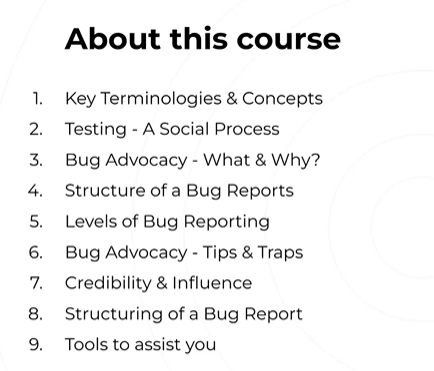

# About this course

1. Key Terminologies & Concepts
2. Testing - A Social Process

```txt
That testing is a social process. We all know that. We do testing to
help our stakeholders make a well informed decision. But testing on
the ground also involves a lot of collaboration between different
stakeholders such as developers, testers.
Product team, the marketing team, and sometimes the customers
and beyond.
```

3. Bug Advocacy - What & Why?

We'll explore why all of this is important and how it affects the bug
advocacy process. After that, we will move on to bug advocacy,
what this concept is, and why it matters.

Bugged Advocacy is essentially the art of effectively communicating
bugs to other stakeholders within your project, outside your project and
we will explore why bug advocacy is important and what in
reality makes it very challenging.

4. Structure of a Bug Reports

We will focus on the structure of a bug report. We will explore the
different components that typically people use to list out a bug
report or a bug description, and how you can effectively
communicate the bug in a clear and concise manner.

5. Levels of Bug Reporting

Next, we will look into the multiple levels of Bug reporting and We will see how you can improve your level from a beginner to an expert with different intricacies and level of detail,
insights and depth that you can enter at each level.

6. Bug Advocacy - Tips & Traps

We will also provide some tips and traps to help you become a
effective bug advocate. This includes talking about strategies for
communicating bugs.
And some kind of common mistakes that people most often all
pray to and how to avoid them.

7. Credibility & Influence

Next, we will talk about credibility
and influence. which are important aspects of Bug
Advocacy, we will explore how to establish credibility and increase your influence as a
tester and how your influence in your project can help. You
actually test better.

8. Structuring of a Bug Report

9. Tools to assist you.
10. Bug Advocacy cheatsheet

```txt
Next, we will dive into the structuring of a bug report. We
will provide examples of effective bug reports and discuss
what makes them

so good, so effective, so well organized. And in the end we
will discuss some tools that can assist you in your bug
advocacy as well as bug reporting

process. I mean, there are a lot of tools out there how to
use them effectively to organize your information and to

communicate them. That's something that comes with
experience with practice and we will cover that and finally
we will provide you with a

bug advocacy cheat sheet that summarizes all these key
Concepts and strategies covered throughout this course,
so, that's all.
```

