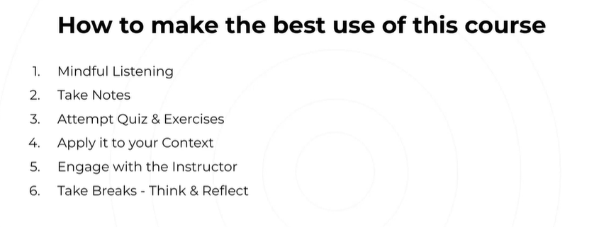
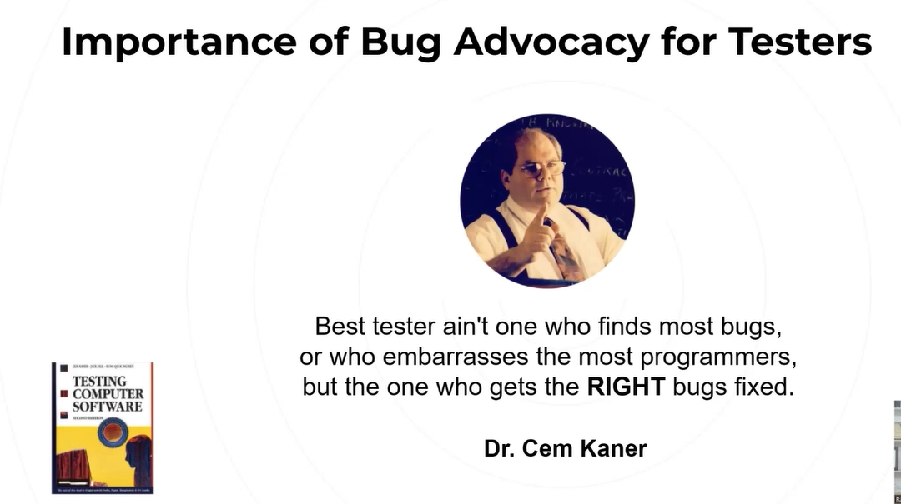
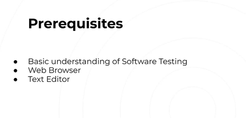
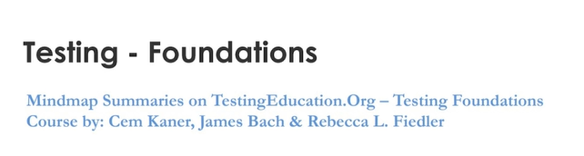

# Module 0 – An Introduction to the Course

## Best Use of this Course



## Before we go ahead with the Course



```txt
In order to achieve this you as a tester would need to become proficient and bug advocacy
as well as in reporting. As part of this course, you will learn
four major things 
first how to advocate for bugs. 
second how to use your bug reports to build credibility 
third be an influential reporter and 
finally how to structure a bug report so that people can read and
gain maximum Insight out of it. 
In conclusion bug advocacy is a critical and foundational skill for testers to master but
becoming proficient in bug advocacy. 
Testers can showcase their value and can directly influence the
decisions and outcome of any project that is on their hand at the moment.
```

> Fish analogy

## Pre-requisites



