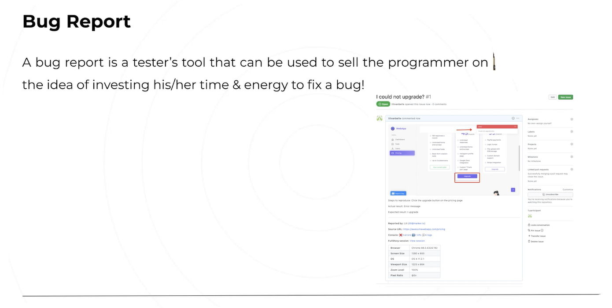
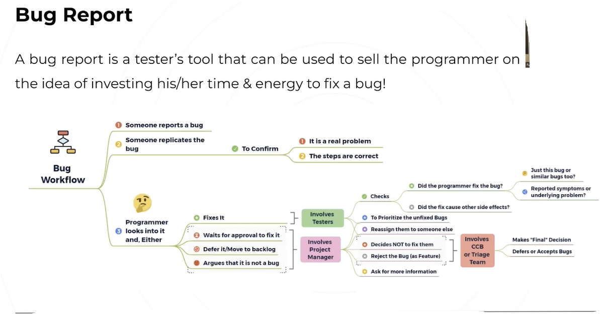
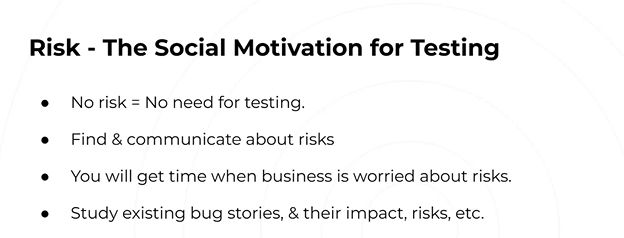
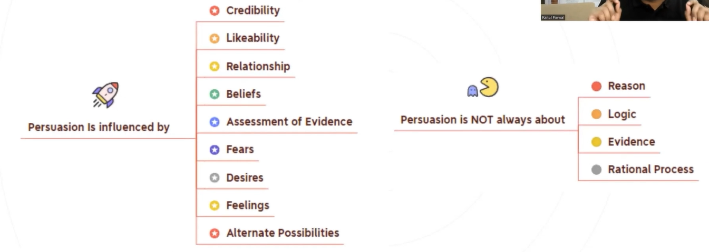

# Module 2 – Testing – A Social Process

## Bug Report



```txt
A bug report is a tester's primary work product. It is something that people instantly notice and remember.
It will also decide the quality of communication that you want to have with your team, your developers as well as with your stakeholders.
As a tester myself, I personally see bug report or bug reporting activity as a tool that can be used to sell the programmer on the idea of investing their time and energy to fix our work.
```

> Why do we need to sell?  
> The reason is pretty simple. we need to sell because we want them to spend their energy to fix the issue, and there is always the possibility that they might choose or might decide to refuse it because there is always more and more work and additional issues.



## Risk - The Social Motivation for Testing

> In this lecture, we will be discussing the importance of identifying and communicating about risks as a software tester  
> Now what is risk? In simple terms risk means a possibility of something bad happening.  
> Now as you may be already knowing that risk is an integral part of the software development process.  
> Every software application system or product today is prone to certain risks. Whether these risks could be related to functionality, security, performance or usability is a totally different aspect, but there are risks that are associated with every software system.

* **No risk = No need for testing.**
  * > As a tester what it means for me is that testing is driven by the need to identify and mitigate risks associated with software development.  
  * > The more complex or critical a system is the higher the risk and greater is the need for testing  
  * > So as a tester of whatever product you are testing always look for the risk aspect of your product  
* **Find and Communicate about risks**
* **You will get time when business is worried about risks** 
  * So for example, if there are concerns about security or compliance as a tester you as a tester can talk aobut them adn you can get a window of opportunity to make a case of deeper testing or investigate issues better or to get the issues fixed.
* **Study existing bug stories, & their impact, risks, etc.**

> Software Bug stories - Ajay Balamurugadas

Link - https://www.scribd.com/document/1032216278/Software-Bug-Stories



## Importance of Persuasion




```txt
Welcome to this lecture on importance of
persuasion in testing. Now when it comes to testing
persuasion is one critical skill that is often
overlooked.

Many testers and specially people who are
beginners in testing belief that if they find a valid
issue if they find a

issue which is critical the developer is going to
automatically fix it. Now in reality, this is not always
the case.

Persuasion plays a very critical role in convincing
developers and team to fix bugs. Now if we
understand the logic behind persuasion,

it's it's not about the reasoning logic evidence or the
rational matter of the subject. Persuasion is often
influenced by a

lot of social factors such as your credibility likeability
relationship beliefs fears desires feelings and other
alternate possibilities. Now as a tester, it's very
important to understand

these factors and know that how all these social
factors can influence the entire persuasion process.
```

```txt
I'll give you an example.

If a tester has a very good relationship with a
specific developer. There are high chances that they
are more likely to listen

and read or understand their bug reports. Well. Now
if a tester presents a bug in a non-threatening polite
manner the developer

may be more receptive to the feedback on the other
hand if we consider that a tester presence a book in
a very confrontational manner

in a very threatening manner the developer may
become defensive and may try to hide the issue or
may become less

feeling to fix the issue. Therefore as a tester. It's
very important for you to understand how to present
Works in a way that is pursuesive as

well as non-threatening. Another important factor to
consider when it comes to persuasion is the
assessment of evidence. 
```

> Search Persuasion in Udemy

```txt
well as non-threatening. Another important factor to consider
when it comes to persuasion is the assessment of evidence.
testers need to be able to provide evidence that

supports their bug report that assists their bug report or that
adds a claim or validity to their bug reports and it's important
to remember

That the developers may be assessing the evidences
differently. So talk to them understand their psychology and
how they look into a report. What are

the things that they probably want to ensure first and make
sure that you give it to them there. So as a tester, it's very
important to understand the developer

perspective. And present your evidences in a way that is
persuasive to them. And it's important for testers to
understand the fears desires and feelings of

developer. A lot of testers never talk to their developers, but
this is a starting step if you want to become persuasive.

Developers may be afraid of introducing new works or
changing a code that is currently working and maybe that's
why they want to push a bug

to next release by understanding these fears testers can
present their bug reports in a way that addresses these
concerns. So in

conclusion pursuition plays a very critical role in testing it is
a social process. And it's not a technical process.

Testos need to understand the factors that influence
persuasion and how to present bugs in a persuasive manner
```