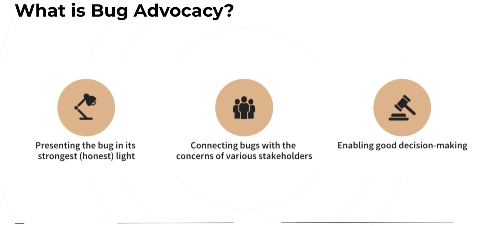
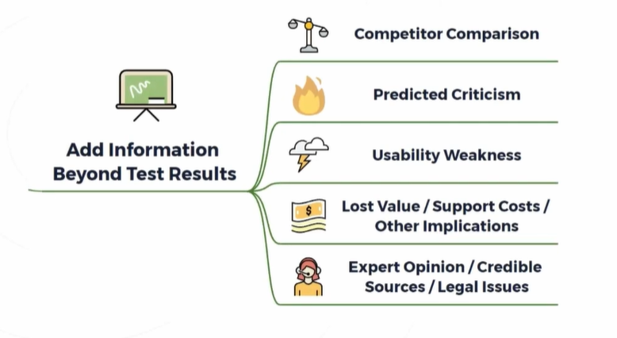
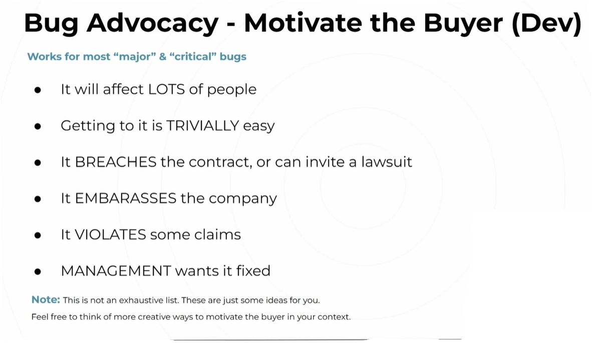
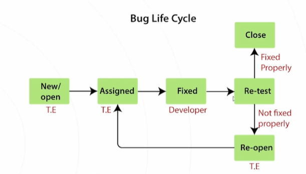
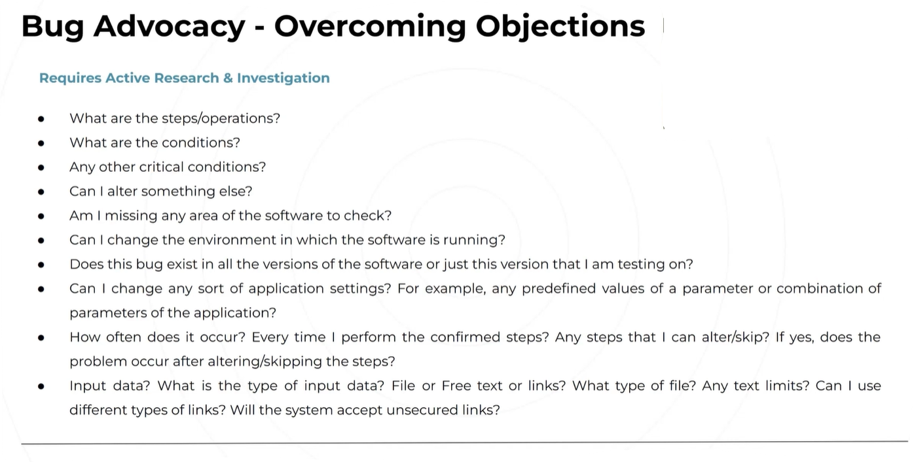

# Module 3 – Bug Advocacy – What & Why?

## What is Bug Advocacy ?



> We will be discussing about what bug advocacy is and why it is such an important foundational skill for testers.  

```txt
So let's start with understanding the term advocacy.
Advocacy is usually an activity that is carried out by
law Professionals in the court or

law jurisdiction to influence decisions within a
political economic or social institutions. Now if we
transport this concept to the software world and

understand what bug advocacy is so bug advocacy is
essentially the act of presenting bugs or software
issues in their strongest and most

honest opinion with a goal of getting the right issues
fixed. Now the key to effective bug advocacy is to
connect

the bugs with the concerns of the stakeholders and
to provide a very clear message that can enable the
stakeholders with good decision making

now this clearly shows that bug. Advocacy is not
just about simplifying the books or reporting them. It
in a deeper sense requires a lot of understanding

of the impact of the works the risks associated with
the books and presenting all of this information in a
way that becomes actionable.
```
* How to be an effective Bug Advocate

```txt
There are a couple of things that you
need to focus on first providing very clear steps of
reproduct reproducing the book as

well. As any relevant information about the system
environment user context the the probability of it
happening the risk associated with it. So all this

information should be provided second part is that
as software is built for people. It's very important
that we connect the bugs with the

concerns of the human stakeholder that how does
this issue impact a human what kind of emotion it
creates in

them? Will it make them angry frustrated angered or
would they be compelled to look for some
Alternatives now all these

emotions are very important when you talk about
bug advocacy. And you have to understand the
priorities and goals of the project as well as the
needs

of the end user. So that's part two of connecting the
concerns of a bug with the concerns of the
stakeholders.

And finally, I mean bug advocacy is very crucial to
enable good decision making and as a tester, I
mean a few provide clear concise information that can quickly help the decision maker
take a well informed decision, whether they want to fix it, leave it , move it to a future release for fixing.
This essentially enables a good decision making process for them.

So by mastering this one foundational skill testers can directly help ensure that most critical bugs are addressed and they can directly contribute to adding value or massive value right from the start.
```

## Selling Bugs

* **Bug Advocacy is Selling Bugs**

"Selling" bugs - Cern Kaner  
"The best tester isn't the one who finds the most bugs, the best tester is the one who gets the right bugs fixed"  


* Motivate the peogrammer
* Demcostrate the bug effects
* Overcome objections
* Increase the defect description coverage indicate detailed preconditions, behavior
* Analyze the failure
* Produce a clear, short, unambiguous bug report
* Advocate error costs

```txt
If you really want somebody to fix
your bug you would have to make them want to do it
and that's the art

of selling comes into play. So let's understand this
art of selling by understanding sales. So if primarily
sales is the art of motivating

someone to do something that you want them to do.
So for example, let's take an example of a
salesperson.

So most of the communication that you would have
ever done with any salesperson would have been
directed towards making you

doing a sale conversion or in simpler words making
you buy a product a service or some additional
higher configuration model. So

the sales person in doing so they would inform you
about the benefits of purchasing the product the
risks or the downside of not purchasing it

why you should do an upgrade of your existing
product and how this could help you in your current
context and life.

```


```txt
A similarly in the context of bug advocacy what it
essentially means is that you have to effectively
communicate about the issues with the

human decision maker who is responsible for
getting this bugs fixed. It's important to understand
that most decision makers are

often very busy and have a limited time resources
and attention and they would have to make a lot of
tough decisions regarding

which books to prioritize which books to fix first or
later in a very quick door duration. So your job as a
bug Advocates is

to convince and help them in this journey of
decision making and help them understand that
which works deserves their time and attention.

Now how would you do this the first and the most
important thing is the quality of information that you

provide them about your bug that will directly affect
the decision made by the decision maker. Now if the
information is vague or it's incomplete

or it's there, but it's too complex. It will be very
difficult for them to understand the severity of the
issue and make an informed decisions

now on the other hand. If the information is pretty
clear concise and you have provided almost all the
necessary details in a very easy to read and
understand manner

then probably they could easily take the appropriate
action.
```



```txt
then probably they could easily take the appropriate
action. Another important thing to know notices that
one thing that separates good professional testers
from

amateurs that professional testers don't just restrict
their testing scope to the product. But they also try
to add information beyond the

test results in their bug reports. Now what can this
additional information be so it could information
about the competitors? How are

our competitors working on a specific feature how
they are providing that feature versus how we are
doing. Any kind of predictive criticism that for
example,

somebody else had also give put out such bugs in
production and what kind of criticism they had to
face if such information can be

added any kind of usability weakness that you
notice in the product. You see there are some
glaring issues or first time user experience
onboarding issues and

maybe because of that the product might not sell
well maybe add that information or some kind of lost
value or support costs that we

might have to face because something is not clear
and the customer will contact our sales team
support team marketing team for more discussions
and their time

might get wasted at such information or any kind of
credible Source legal issue that has happened in
the past or any expert opinion in your team or any expert
opinion or in your domain try to add that.
```

```txt

So in conclusion professional testers always try to look
beyond the test results always try

to stretch their boundaries. They try to
communicate in a very clear concise and effective
Manner and that's how they're able to sell the

bugs and this ability to sell the bugs is an essential
aspect of bug advocacy.
```

## Motivating the Buyer



1. It will affect LOTS of people

```txt
Hello. In this video lecture will be discussing an
important bug. Advocacy strategy. That is to
motivate your buyer. Now your buyer in your

software context is your development team. So as a
software tester, you have a very crucial role in
identifying and Reporting books. However, that's

just the beginning. You will have to eventually
motivate your first level buyer. That is your
development team. To prioritize fixing the write
books.

now this strategy is going to work in addressing
most of your major to critical Works without you
having to spend too much time in a

lot of further investigation and Analysis and
research so let's start and understand what are
some of the most obvious motivators

for Developers? So first is if a bug affects a large
number of users now if there is a bug that impacts a
significant portion of

your user base that can essentially cause a loss of
Revenue it can essentially even damage your
product reputation your brand reputation and can

even be susceptible to flooding with a lot of user
complaints. Now highlighting an impact from the end
user

perspective and from the business perspective in a
bug can very easily convince the development team
to prioritize such books.
```

2. Getting to it is TRIVIALLY easy




```txt
So it's important to understand that this is not a very
exhaustive list. These are some of the ideas that I
wanted to share you.

And feel free to think of more creative ways how
you can essentially motivate your development
team in your context how you work and if

you have some interesting idea do share them with
me too.
```

## Overcoming Objections

```txt
Hello and welcome to this lecture on bug advocacy
overcoming objections. So in the last lecture, we
learned one essential way

of selling works that is by motivating the developer.
However, it's not always very easy to convince your
development team that a bug

needs their attention and this gets more difficult if
the bug falls into the category of being inconsistent
irreproducible or

it appears to be a less generic or less serious issue
in the first glance. So in this lecture, we'll discuss a
second strategy of

selling books. That is by overcoming objections the
objections that testers often face after reporting
books. So one thing to understand is that this
approach.

Will require more active research investigation and
can be a little time consuming. So advice of caution
to understand is that

you have to know when to stop and when you have
to move to the next work as testing is a lot about
trade-offs.

So the more you invest in one work the less you
would have the time for any subsequent test round

or testing effort or testing activity. So if you are not
sure about a bug yourself my advice would be you
can mark the book as inconsistent assigned

to your own self. You can add more test notes
observation on that report till you find enough
evidence and then assign it to a developer so in
case wehre you feel that a developer can assist you.
```

