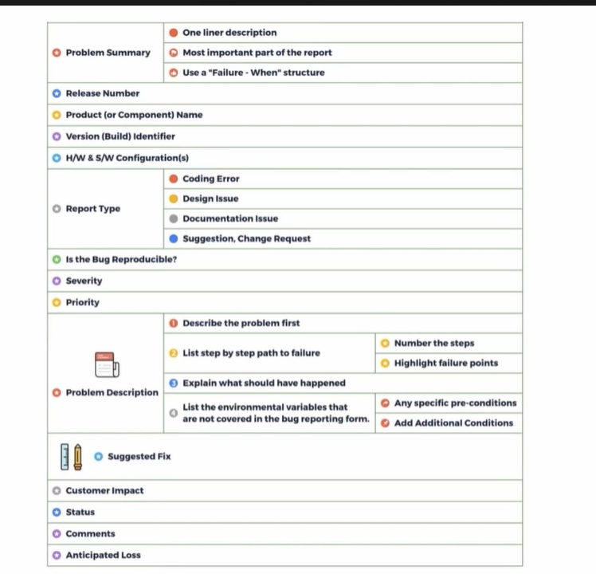
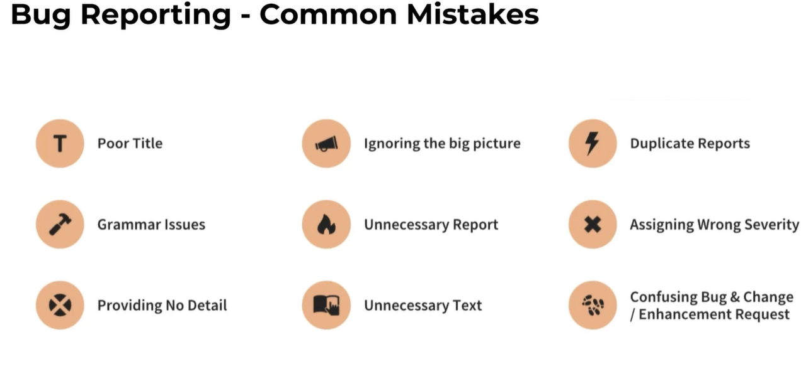
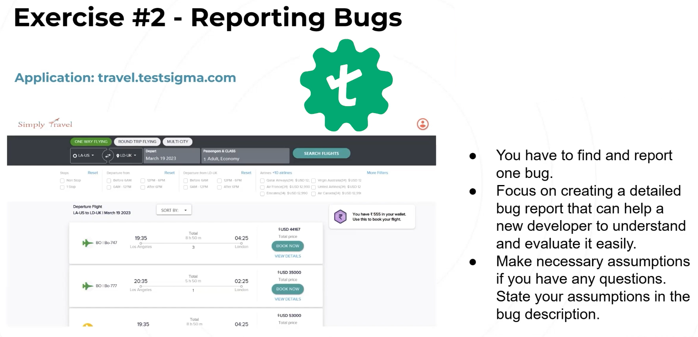
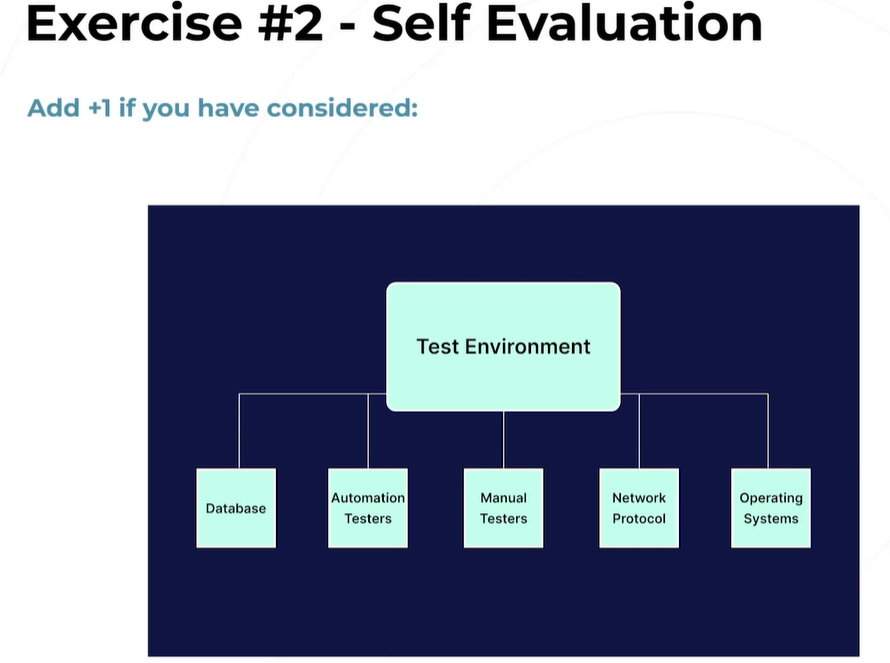
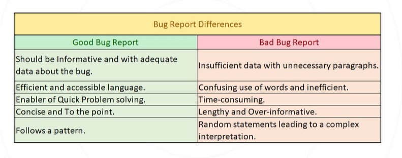
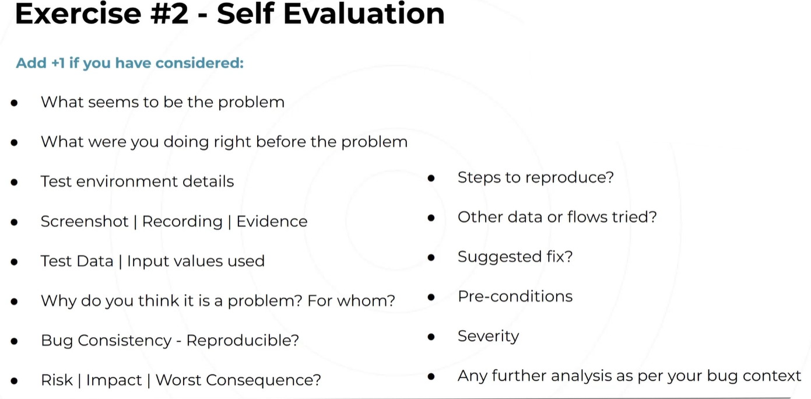

# Module 4 – Structure of a Bug Report

## Structure of a Bug Report



## Common Mistakes during Bug Reporting



## Exercise – Reporting Bugs



## Self-Evaluation







```txt
So in conclusion self-evaluating your

mother report as an important step in ensuring its
Effectiveness and you would have to periodically
assess your own report. Even I do that and find
ways that how you can improve it from the reader's
perspective from the perspective of a developer or a project lead or a scrum master.

So think on those lines, how can you make it more
crisp more better? How can you communicate
effectively? That's the essence so, that's all.
```