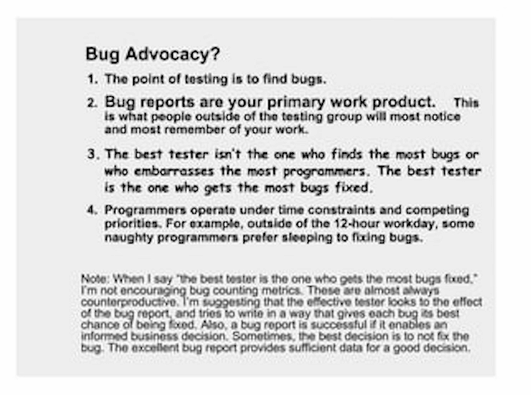
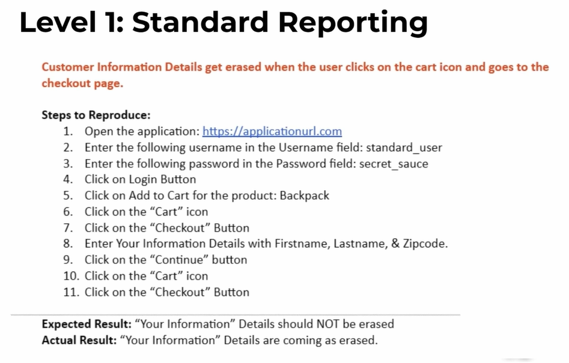
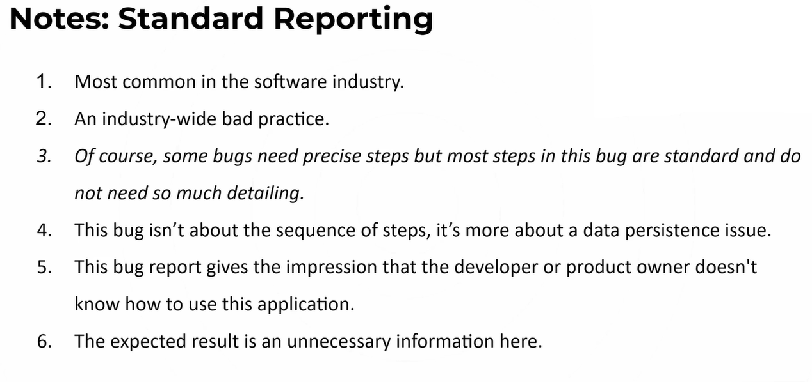
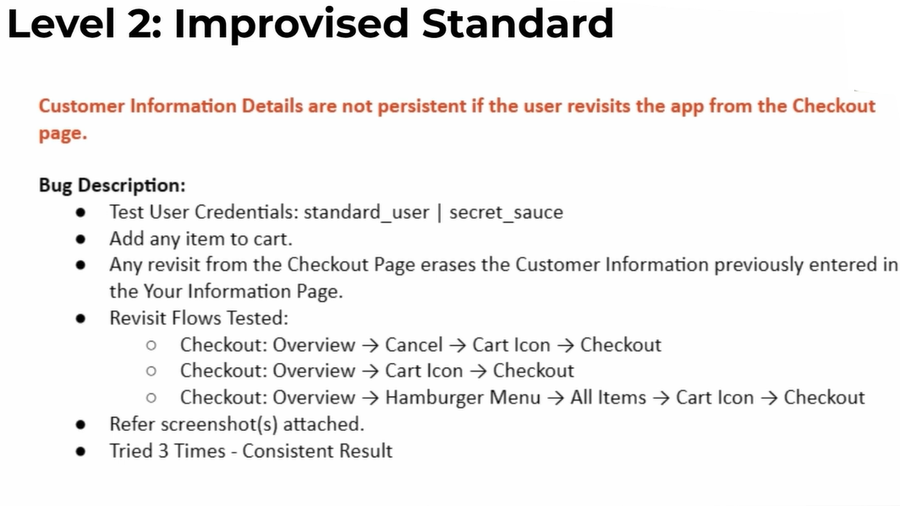
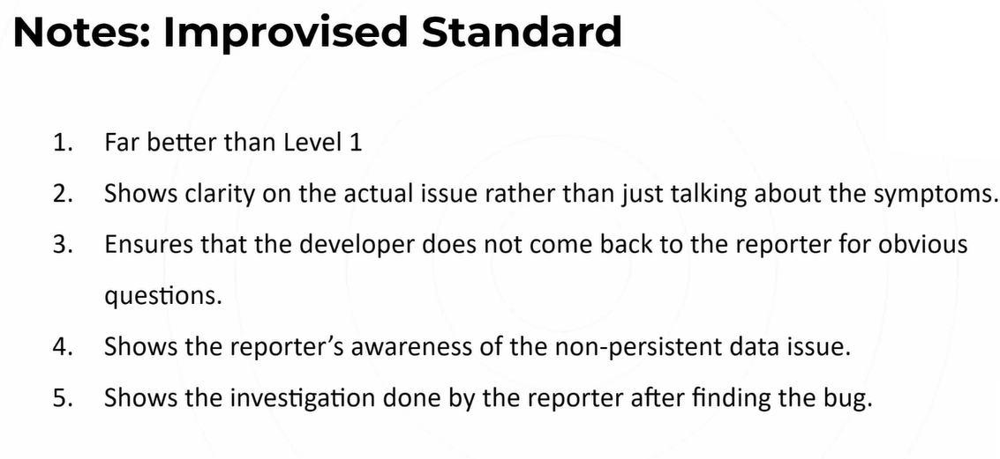
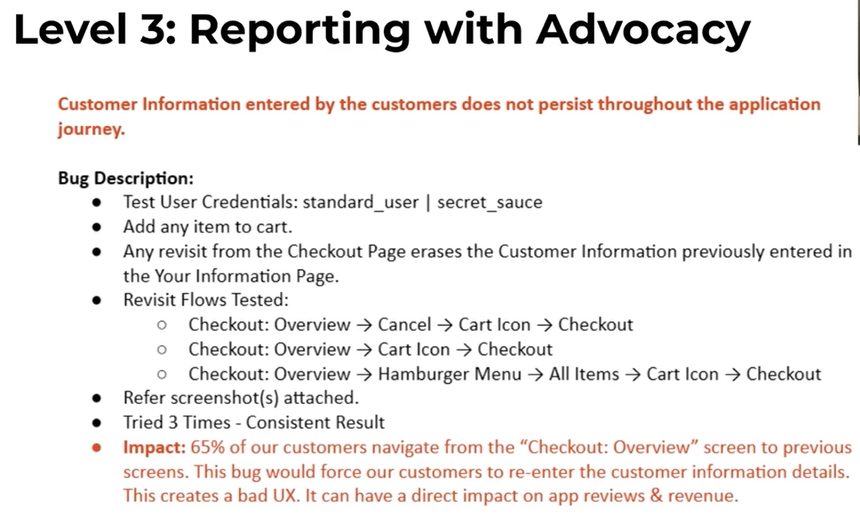
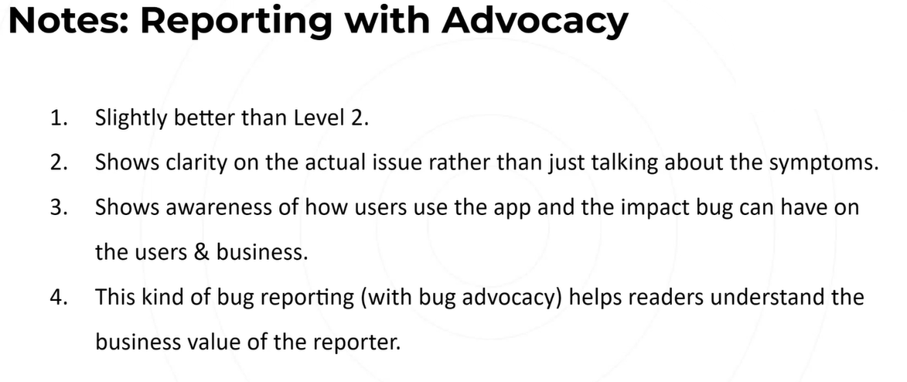

# Module 5 – Levels of Bug Reporting

## Levels of Bug Reporting

1. Standard Reporting
2. Improvised Standard
3. Reporting with Advocacy

4. Reporting with Advocacy & Investigation

5. Contextual Reporting

## Standard Reporting

## Improvised Standard

## Reporting with Advocacy

## Level 4: Reporting with Advocacy & Investigation

