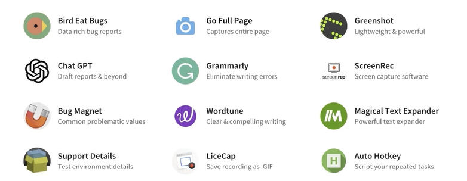
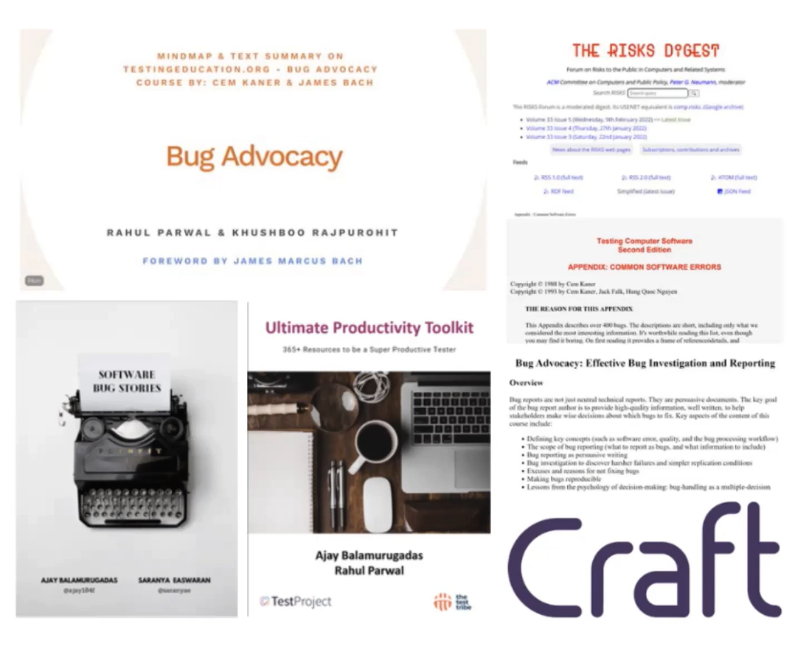

# Module 9 – Tools to assist you

## Tools



```txt
I wanted to share some of the useful
tools that have helped

me with bug reporting and advocacy. But before I
talk about my tools, I just want to leave one
disclaimer that

no tool is perfect. Try to think of three tools or
minimum three tools for doing every task. There are

alternatives available for each and every of this tool.
These are just the tools that I have used and have
worked for me.

And I hope they work for you. But at the same time
don't restrict your tooling or toolkit to just these
tools, but try to explore more tools
```

## Further Resources



https://www.thetesttribe.com/wp-content/uploads/2021/10/Ultimate-Productivity-Toolkit.pdf